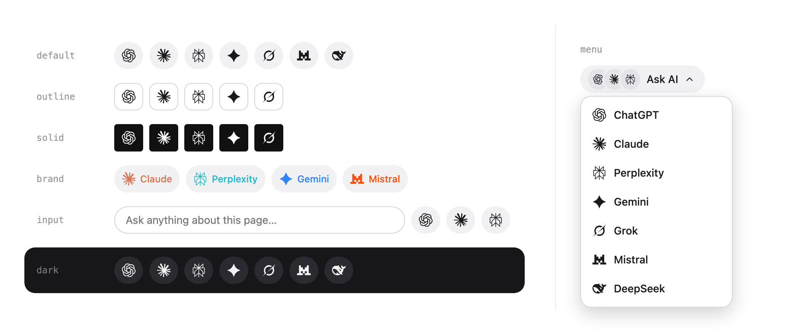

# ask-ai-widget

**"Ask AI about this page" in one tag.** A tiny button row that opens ChatGPT, Claude, Perplexity, Gemini, Grok, Mistral or DeepSeek in a new tab with a prefilled prompt. No backend, no tracking, no dependencies.



[](#bundle-size)
[](package.json)
[](LICENSE)
[](#api-reference)

**[Try the playground](demo/index.html)** - configure the widget live, see the exact prompt it sends, and copy the snippet for HTML, vanilla JS, React, Vue or Svelte.

## Quick start in 30 seconds

```html
<script src="https://cdn.jsdelivr.net/npm/ask-ai-widget@0/dist/ask-ai.min.js"></script>

<ask-ai label="Ask AI about this page"></ask-ai>
```

That is the whole integration. Every button opens its service with a prompt that contains the page title and URL. For production, pin an exact version (`ask-ai-widget@0.1.0`): while the major version is 0, `@0` can receive breaking changes.

Make it answer a visitor's own question instead:

```html
<ask-ai input placeholder="Ask anything about this page" services="claude,chatgpt,perplexity"></ask-ai>
```

## Let your AI coding agent do it

Copy this prompt (use the copy button in the corner of the block) and paste it into Claude Code, Cursor, Copilot, Codex or any other coding agent working in your project:

```text
Add the ask-ai-widget "Ask AI" button row to this project.

1. Install it with this project's package manager: npm install ask-ai-widget
   (For a plain HTML site with no build step, use the CDN script instead:
   https://cdn.jsdelivr.net/npm/ask-ai-widget@0/dist/ask-ai.min.js)
2. Read node_modules/ask-ai-widget/llms.txt before writing any code. It lists
   the right import for each framework, every option, and the common mistakes.
3. Detect the framework and use its entry: React/Next.js -> ask-ai-widget/react,
   Vue/Nuxt -> ask-ai-widget/vue, Svelte/SvelteKit -> ask-ai-widget/svelte,
   anything else -> the <ask-ai> element from ask-ai-widget/element.
4. Place the widget where I ask below (or suggest a spot, e.g. under the docs
   page title). Use label "Ask AI about <my product>" and keep the default
   page context (title + URL) unless I say otherwise.
5. Prompts must be strings or synchronous functions. Never await inside them,
   or browsers block the new tab.
6. With SSR (Next.js, Nuxt, SvelteKit), import "ask-ai-widget/style.css" in the
   root layout, and pass page={{ url, title }} so server and client links match.
7. Style it only through --aai-* CSS variables or the .aai__* classes; don't
   copy or edit the library CSS.
8. Show me the diff and how to see it running.

Where and how I want it:
<describe the page, the services you want, and predefined prompt vs. visitor question>
```

The same guide is published at [`llms.txt`](llms.txt), so agents that read llms.txt files pick it up on their own.

## Contents

- [Let your AI coding agent do it](#let-your-ai-coding-agent-do-it)
- [Install](#install)
- [Frameworks](#frameworks): [HTML](#html--web-component), [Vanilla JS](#vanilla-js), [React / Next.js](#react--nextjs), [Vue / Nuxt](#vue--nuxt), [Svelte](#svelte), [Astro and others](#astro-and-other-frameworks)
- [Two modes: predefined prompt or user question](#two-modes)
- [Prompt composition](#prompt-composition)
- [Services](#services)
- [Dropdown menu](#dropdown-menu)
- [Translations](#translations)
- [Styling](#styling)
- [Bundle size and tree-shaking](#bundle-size)
- [Events and analytics](#events-and-analytics)
- [API reference](#api-reference)
- [Accessibility](#accessibility), [Privacy](#privacy), [Browser support](#browser-support)
- [FAQ and troubleshooting](#faq-and-troubleshooting)
- [Trademarks](#trademarks), [Contributing](#contributing), [License](#license)

## Install

```bash
npm install ask-ai-widget
# pnpm add ask-ai-widget
# yarn add ask-ai-widget
```

React, Vue and Svelte are optional peer dependencies. You only need the one you use. The package ships ESM, CJS and `.d.ts` files for every entry.

| Import | What you get |
| --- | --- |
| `ask-ai-widget` | Core API (`mount`, `getItems`, `buildPrompt`, ...) with all 7 services built in |
| `ask-ai-widget/element` | Registers `<ask-ai>` (side effect) and exports the element class |
| `ask-ai-widget/react` | `AskAI` component |
| `ask-ai-widget/vue` | `AskAI` component and `plugin` |
| `ask-ai-widget/svelte` | `askAI` action |
| `ask-ai-widget/style.css` | The complete stylesheet as a file, row and menu layout (optional, for zero-FOUC SSR) |
| `ask-ai-widget/style-row.css` | The same without the dropdown rules, for SSR pages that only use the row layout |
| `ask-ai-widget/lite`, `lite/element`, `lite/react`, `lite/vue`, `lite/svelte` | Same APIs without the built-in logos, for [tree-shaking](#bundle-size) |
| `ask-ai-widget/services` | The service objects: `chatgpt`, `claude`, `perplexity`, `gemini`, `grok`, `mistral`, `deepseek`, `builtins` |
| CDN `dist/ask-ai.min.js` | One file, global `AskAI`, auto-defines `<ask-ai>`, auto-mounts `[data-ask-ai]` |

## Frameworks

### HTML / Web component

```html
<script src="https://cdn.jsdelivr.net/npm/ask-ai-widget@0/dist/ask-ai.min.js"></script>

<ask-ai
  services="claude,chatgpt,perplexity"
  label="Ask AI about this page"
  variant="outline"
  show-labels
></ask-ai>
```

With a bundler, `import "ask-ai-widget/element";` registers the tag instead.

`<ask-ai>` renders into its own light DOM, so your CSS applies. Configure it with attributes, with JS properties, or both (properties win):

| Attribute | Property | Value |
| --- | --- | --- |
| `services` | `services` | comma list of keys: `"claude,chatgpt"` |
| `label` | `label` | text before the buttons |
| `variant` | `variant` | `soft` (default), `outline`, `solid`, `ghost`, `brand`, or your own name |
| `shape` | `shape` | `circle` (default), `rounded`, `square` |
| `size` | `size` | `sm`, `md` (default), `lg` |
| `theme` | `theme` | `light` (default), `dark`, `auto` |
| `layout` | `layout` | `row` (default) or `menu`, see [Dropdown menu](#dropdown-menu) |
| `menu-align` | `menuAlign` | menu layout: `start` (default) or `end` |
| `menu-icons` | `menuIcons` | menu layout: `stack` (default, logos in the trigger) or `none` |
| `show-labels` | `showLabels` | boolean attribute |
| `prompt` | `prompt` | template string, see [Prompt composition](#prompt-composition) |
| `instructions` | `instructions` | template string placed before the prompt |
| `context` | `context` | template string, or `none` / `false` to drop it |
| `references` | `references` | comma list of URLs |
| `template` | `template` | how the parts are joined |
| `vars` | `vars` | JSON object: `vars='{"product":"Example"}'` |
| `page` | `page` | JSON object: `page='{"url":"https://example.com/x","title":"X"}'` |
| `max-length` | `maxLength` | number, default 4000 |
| `input` | `input` | bare `input` = built-in field; `input="#q"` = existing field; `input="false"` = off |
| `placeholder`, `required`, `multiline` | part of `input` | options of the built-in field (`placeholder` alone also turns the field on). With `input="#q"`, only `required` applies: `input="#q" required="false"` allows an empty question |
| `strings` | `strings` | JSON object that translates the widget's own texts: `strings='{"ask":"Frage {service}"}'`, see [Translations](#translations) |
| `submit-service` | `submitService` | key opened by Enter in the input |
| `class-name` | (use `class`) | extra classes added to the root. `class` itself works too |
| `unstyled` | `unstyled` | boolean attribute, skip the default CSS |
| - | `onOpen` | function, property only |
| - | `options` | `el.options = { ... }` sets several properties at once |

Properties may be functions and are batched into one render:

```js
const el = document.querySelector("ask-ai");
el.prompt = (ctx) => `Explain ${ctx.title} to a beginner`;
el.onOpen = ({ service }) => console.log(service);
```

No JS needed for a CDN page with several widgets either: `<div data-ask-ai data-services="claude,chatgpt"></div>` is auto-mounted with the same attribute grammar using a `data-` prefix (`data-show-labels`, `data-layout="menu"`, `data-input`, ...). Call `AskAI.init()` after adding more to the DOM.

### Vanilla JS

```js
import { mount } from "ask-ai-widget";

const widget = mount("#ask-ai", {
  services: ["claude", "chatgpt"],
  label: "Ask AI about this page",
  prompt: (ctx) => `Summarize ${ctx.title} in 3 bullets.`,
  onOpen: ({ service, prompt }) => console.log(service, prompt),
});

widget.update({ variant: "outline" }); // merges options and re-renders
widget.destroy();                       // removes DOM, listeners, classes
```

`mount(target, options)` accepts an element or a selector and returns `{ element, update, destroy }`, or `null` when the target does not exist. Mounting the same element twice replaces the first instance.

### React / Next.js

```tsx
import { AskAI } from "ask-ai-widget/react";

export function Share() {
  return (
    <AskAI
      services={["claude", "chatgpt", "perplexity"]}
      label="Ask AI about this page"
      variant="outline"
      onOpen={({ service }) => track(service)}
    />
  );
}
```

The component renders real `<a href>` elements on the server, forwards `ref` to the root `<div>`, passes `id`, `style`, `data-*` and other DOM props through, and needs no memoisation for inline function props. Extra props: `question` / `defaultQuestion` / `onQuestionChange` for the built-in input.

```tsx
const [q, setQ] = useState("");
<AskAI input question={q} onQuestionChange={setQ} />
```

**Next.js (App Router) notes**

- `"use client"` is built into `ask-ai-widget/react`, so you can import it from Server Components.
- Import the stylesheet once, for example in `app/layout.tsx`, so the widget is styled in the server HTML (no flash of unstyled buttons): `import "ask-ai-widget/style.css";`
- Pass `page={{ url, title }}` so server-rendered hrefs equal the client's. The component re-syncs hrefs from the live document after hydration anyway, but with `page` the HTML that crawlers, middle-click and "copy link" see is already correct:
  ```tsx
  <AskAI page={{ url: `https://example.com/docs/${slug}`, title }} />
  ```
- Functions cannot cross the Server to Client boundary. From a Server Component pass strings and objects only (`prompt="Explain {title}"`). If you need `prompt={(ctx) => ...}` or `onOpen`, put the widget in your own `"use client"` file.

### Vue / Nuxt

```vue
<script setup>
import { ref } from "vue";
import { AskAI } from "ask-ai-widget/vue";
const q = ref("");
</script>

<template>
  <AskAI
    :services="['claude', 'chatgpt']"
    label="Ask AI about this page"
    input
    v-model:question="q"
    @open="({ service }) => console.log(service)"
  />
</template>
```

Register globally with the plugin: `import { plugin } from "ask-ai-widget/vue"; app.use(plugin);`. The component renders real anchors during SSR, emits `open` before a service opens and `update:question` for the built-in input, and lets `class`, `style` and `id` fall through. Use `show-labels` or `:show-labels="true"` for `showLabels`. For Nuxt, pass `:page="{ url, title }"` to make server and client hrefs identical.

### Svelte

```svelte
<script>
  import { askAI } from "ask-ai-widget/svelte";
</script>

<div use:askAI={{ services: ["claude", "chatgpt"], label: "Ask AI about this page" }}></div>
```

Works in Svelte 3, 4 and 5. Updating the options object re-renders; keys you remove fall back to their defaults. An action runs in the browser, so the server sends an empty `<div>`.

### Astro and other frameworks

Anything that can output HTML can use the element. Astro:

```astro
<ask-ai services="claude,chatgpt" label="Ask AI about this page"></ask-ai>
<script>import "ask-ai-widget/element";</script>
```

In Angular add `CUSTOM_ELEMENTS_SCHEMA`; in Solid, Lit, Alpine or plain templates just write the tag. Booleans are attributes (`show-labels`), objects are JSON attributes or element properties.

## Two modes

**Predefined prompt (default).** Clicking a button opens the service with a fixed prompt, by default `Explain this page.` plus the page context.

**User question.** Add `input` and the visitor types what they want to know. The default prompt becomes `{question}`.

```html
<!-- built-in field -->
<ask-ai input placeholder="Ask about this page"></ask-ai>

<!-- your own field, selected by CSS selector (or pass the element in JS) -->
<input id="q" placeholder="Ask anything">
<ask-ai input="#q" label="Ask"></ask-ai>
```

```js
mount("#w", { input: true });                                      // built-in field
mount("#w", { input: { placeholder: "Ask...", multiline: true } }); // textarea, required defaults to true
mount("#w", { input: "#q" });                                      // existing field, by selector
mount("#w", { input: document.querySelector("#q") });              // existing field, by element
mount("#w", { input: { target: "#q", required: false } });         // existing field, empty question allowed
```

Behaviour:

- Clicking any button opens that service with the typed question. In this mode the buttons are the field's submit action: they always sit directly to the right of the field (in the menu layout, the trigger does), on one row with the label. On narrow containers (about 440px and below) the label moves above and the field and buttons stay together on one row below it; below about 400px the buttons shrink to the `sm` size. The field follows `variant`, `shape`, `size` and `theme` like the buttons (soft: same fill; outline: same border; solid: same fill with light text; ghost: transparent with a faint border).
- **Enter** in the field opens `submitService` (default: the first service). In a textarea, **Shift+Enter** inserts a new line. IME composition is respected.
- `required` (default `true`) blocks opening when the question is empty: the field gets `aria-invalid="true"` and focus. Set `input: { required: false }` on the built-in field to allow empty questions. For an existing field use `input: { target: "#q", required: false }` (element attribute: `input="#q" required="false"`, CDN auto-mount: `data-input="#q" data-required="false"`); a bare selector or element is always required.
- Hover and keyboard focus refresh the buttons' `href` with the current question, so middle-click and "copy link address" carry it.
- Combine with a custom prompt: `prompt: "Answer using this page. Question: {question}"`.

## Prompt composition

The text sent is assembled from four parts and a template.

| Part | Option | Default |
| --- | --- | --- |
| Instructions | `instructions` | none |
| Prompt | `prompt` | `{question}` with `input`, otherwise `Explain this page.` |
| Context | `context` | `Context: {title} — {url}` (just the URL if there is no title). `false` disables |
| References | `references` | none. Renders as `Use these sources:` and one `- url` line per entry |

They are joined with the `template`, default `{instructions}\n\n{prompt}\n\n{context}\n\n{references}`. Empty parts vanish and runs of blank lines collapse.

**Placeholders** work in `prompt`, `instructions`, `context` and `template`:

| Placeholder | Value |
| --- | --- |
| `{question}` | what the visitor typed (empty without `input`) |
| `{url}` | `page.url`, else `location.href` |
| `{title}` | `page.title`, else `document.title` |
| `{description}` | `page.description`, else `<meta name="description">` |
| `{selection}` | the text the visitor has selected on the page |
| `{service}` | the key of the service being opened |
| `{anything}` | any key of `vars` |

Unknown placeholders become an empty string, so a literal `{curly}` in your text disappears. Built-in names win over a `vars` entry of the same name. In `template` you can also use `{instructions}`, `{prompt}`, `{context}` and `{references}`.

**Strings or functions.** Any part can be a function of the context. It runs synchronously at click time, and its return value is used as is (no placeholder expansion):

```js
mount("#w", {
  prompt: (ctx) => `Compare ${ctx.title} with the alternatives.`,
  references: (ctx) => ["/llms.txt", ctx.url],
});
```

`ctx` is `{ service, question, url, title, description, selection, vars }`.

**Relative references** resolve against the page URL (`page.url`, else `location.href`), are de-duplicated, and empty entries are dropped.

**`maxLength`** (default 4000 characters) keeps URLs manageable. When the text is too long it is shortened in this order: context (with an ellipsis), then references one line at a time from the end, then instructions, and only then the prompt itself. A final hard cut never splits a surrogate pair.

### Worked example

```js
mount("#w", {
  services: ["claude", "gemini"],
  instructions: "You are a helpful {product} support engineer. Answer concisely.",
  prompt: "Explain this page to a beginner.",
  references: ["/llms.txt", "/docs/api"],
  vars: { product: "Example" },
  page: { url: "https://example.com/docs/quickstart", title: "Quickstart | Docs" },
});
```

The text sent to Claude (`https://claude.ai/new?q=` + URL-encoded text):

```text
You are a helpful support engineer. Answer concisely.

Explain this page to a beginner.

Context: Quickstart | Docs — https://example.com/docs/quickstart

Use these sources:
- https://example.com/llms.txt
- https://example.com/docs/api
```

Preview any configuration without clicking: `AskAI.buildPrompt(opts, AskAI.getContext(opts, question, serviceKey))` (the same functions are exported from `ask-ai-widget`), or use the [playground](demo/index.html).

## Services

| Key | Label | URL (prompt goes in `?q=`) | Prefill |
| --- | --- | --- | --- |
| `chatgpt` | ChatGPT | `https://chatgpt.com/` | yes, auto-submits (verified Oct 2026) |
| `claude` | Claude | `https://claude.ai/new` | yes; logged-out users go through sign-in and the prompt is kept |
| `perplexity` | Perplexity | `https://www.perplexity.ai/search` | yes, auto-submits (verified Oct 2026) |
| `gemini` | Gemini | `https://gemini.google.com/app` | **no**: copied to clipboard |
| `grok` | Grok | `https://grok.com/` | yes, Grok asks the user to confirm sending (verified Oct 2026) |
| `mistral` | Mistral | `https://chat.mistral.ai/chat` | yes, **unverified** |
| `deepseek` | DeepSeek | `https://chat.deepseek.com/` | **no**: copied to clipboard |

- **Order matters.** `services` renders in the order you give; omit it for all seven in the table order. Keys are case-insensitive. Unknown keys are dropped with a console warning.
- **Gemini and DeepSeek** have no reliable URL prefill. The widget copies the prompt to the clipboard, shows "Prompt copied — paste it into Gemini" in a polite live region for four seconds, and opens the site. The `?q=` parameter is still appended in case the service starts honouring it. Clipboard access needs HTTPS (a secure context); without it the site opens with no hint.
- **Mistral's** `?q=` comes from third-party documentation and has not been verified by this project. It is treated as prefilled. If it does not work for you, override it: `registerService({ ...mistral, prefill: false })`.
- URL formats of third-party products change without notice. If one breaks, override it with `registerService` until a release catches up.

### Custom services

Add a service for the whole page with `registerService`, or pass an object inline:

```js
import { mount, registerService } from "ask-ai-widget";

registerService({
  key: "kagi",
  label: "Kagi",
  url: "https://kagi.com/assistant",
  param: "q",
  icon: "M12 2 L22 22 H2 Z", // path data for a 24x24 viewBox, filled with currentColor
  color: "#FFB319",           // used by variant="brand"
});

mount("#w", { services: ["claude", "kagi"] });
mount("#w", { services: ["claude", { key: "me", label: "My AI", url: "https://ai.example.com/", param: "prompt" }] });
```

`ServiceDef` is `{ key, label, url, param, icon?, color?, prefill? }`. Set `prefill: false` for services that ignore the parameter to get the copy-to-clipboard behaviour. A registered service with a built-in's key replaces it.

**Icon fallback.** A service without an `icon` renders the first character of its label in the circle (emoji-safe). With `showLabels` the letter is followed by the service name, like every other service (React, Vue and `mount` render the same).

## Dropdown menu

`layout: "menu"` replaces the row of logos with one **Ask AI** button. Clicking it opens a menu that lists every service (logo and name); choosing one does exactly what clicking its button in the row does: the required-question check, the clipboard fallback and hint for Gemini and DeepSeek, `onOpen`, the `ask-ai:open` event and `window.open`, all synchronous. Middle-click and Ctrl/Cmd-click on an item keep the browser's native link behaviour.

```html
<ask-ai layout="menu" services="chatgpt,claude,perplexity,gemini" label="Ask AI"></ask-ai>
<!-- right-aligned menu, no logos in the trigger -->
<ask-ai layout="menu" menu-align="end" menu-icons="none"></ask-ai>
<!-- CDN auto-mount -->
<div data-ask-ai data-layout="menu"></div>
```

```js
import { mount } from "ask-ai-widget";
mount("#w", { layout: "menu", label: "Ask AI", menuAlign: "end" });
```

```tsx
import { AskAI } from "ask-ai-widget/react";
<AskAI layout="menu" menuAlign="end" />
```

```vue
<AskAI layout="menu" menu-align="end" />
```

```svelte
<div use:askAI={{ layout: "menu", menuAlign: "end" }}></div>
```

| Option | Default | Notes |
| --- | --- | --- |
| `layout` | `"row"` | `"menu"` turns on the dropdown. Attribute `layout`, CDN `data-layout` |
| `label` | `strings.menu`, else `"Ask AI"` | In the menu layout `label` is the trigger text (it is not rendered as a separate label). Also the accessible name of the menu |
| `strings.menu` | `"Ask AI"` | Default trigger text when no `label` is set, so translated pages need no `label` |
| `menuAlign` | `"start"` | `"end"` lines the menu up with the right edge of the trigger. Attribute `menu-align` |
| `menuIcons` | `"stack"` | `"stack"` shows up to three overlapping logos (the first services that have an icon) in the trigger; `"none"` shows only the label and chevron. Attribute `menu-icons` |

Menu items always show the service name. `showLabels` and `strings.ask` do not apply to them (the visible name is the accessible name). The built-in input still works: the field is rendered next to the trigger, and choosing a service with an empty required question closes the menu and focuses the field.

**Keyboard.** On the trigger, ArrowDown, Enter or Space open the menu and focus the first item; ArrowUp opens it and focuses the last. In the menu, ArrowDown and ArrowUp move with wrap-around, Home and End jump to the ends, a letter jumps to the next item starting with it, Space or Enter activates, Escape closes and returns focus to the trigger, and Tab closes without trapping focus. A press outside the widget closes the menu. The menu is a `role="menu"` list of `role="menuitem"` links opened by a `<button aria-haspopup="menu" aria-expanded aria-controls>`.

**Position.** The menu is absolutely positioned below the trigger (the root is `position: relative` in this layout). When it does not fit below the trigger and there is more room above, it flips above (`data-placement="top"` on the menu). The position is measured when the menu opens, so it does not follow a later resize or scroll. Open state lives in the DOM (`aria-expanded` and `hidden`), so React and Vue re-renders do not close it.

Markup (identical in every renderer):

```html
<div class="aai" data-layout="menu" data-variant="soft" ...>
  <button type="button" class="aai__trigger" aria-haspopup="menu" aria-expanded="false" aria-controls="ID">
    <span class="aai__stack" aria-hidden="true">
      <span class="aai__stack-item aai__btn--claude" style="--aai-brand:#D97757"><svg class="aai__icon">...</svg></span>
    </span>
    <span class="aai__trigger-label">Ask AI</span>
    <svg class="aai__chevron" aria-hidden="true">...</svg>
  </button>
  <div class="aai__list aai__menu" role="menu" id="ID" aria-label="Ask AI" hidden>
    <a class="aai__btn aai__btn--claude" role="menuitem" tabindex="-1" data-service="claude" href="..."><svg class="aai__icon">...</svg><span class="aai__name">Claude</span></a>
  </div>
  <div class="aai__hint" role="status" aria-live="polite"></div>
</div>
```

**Styling.** `variant`, `shape`, `size` and `theme` apply to the trigger like to the buttons, and the `--aai-bg`, `--aai-bg-hover`, `--aai-fg`, `--aai-border`, `--aai-radius`, `--aai-shadow` and `--aai-btn-size` properties work on it. `variant="brand"` colors the logos in the stack and in the menu. The panel has its own properties:

| Property | Default (light / dark) | Purpose |
| --- | --- | --- |
| `--aai-menu-bg` | `#fff` / `#1c1c1e` | panel background |
| `--aai-menu-fg` | `#1a1a1a` / `#f2f2f2` | item text color |
| `--aai-menu-border` | `#d4d4d9` / `#46464c` | panel border color |
| `--aai-menu-shadow` | `0 8px 24px rgba(0,0,0,.18)` | panel shadow |
| `--aai-menu-radius` | `min(radius, 14px)` | panel radius (items use `min(radius, 10px)`) |
| `--aai-menu-z` | `1000` | z-index |

Hover and focus rows use `--aai-tint`. The panel is at least 200px wide. With `prefers-reduced-motion` the transitions are off.

## Translations

The widget writes four texts itself. Override any of them with `strings`; `{service}` is replaced by the service label. Omitted keys keep the English default.

| Key | Used for | Default |
| --- | --- | --- |
| `ask` | `aria-label` and `title` of each button | `Ask {service}` |
| `question` | `aria-label` of the built-in question field | `Your question` |
| `copied` | hint after the prompt was copied (Gemini, DeepSeek) | `Prompt copied — paste it into {service}` |
| `menu` | trigger text of the [dropdown menu](#dropdown-menu) when no `label` is set | `Ask AI` |

```js
mount("#w", { input: true, label: "Frag die KI", strings: { ask: "{service} fragen", question: "Deine Frage", copied: "Kopiert. Füge es in {service} ein." } });
```

```html
<ask-ai label="Frag die KI" strings='{"ask":"{service} fragen","copied":"Kopiert. Füge es in {service} ein."}'></ask-ai>
```

React and Vue take `strings` as a prop (`:strings` in Vue), Svelte as a key of the action options, the CDN auto-mount as `data-strings='{...}'`. The accessible name of the button group is your `label`; in the menu layout the trigger text is your `label`, else `strings.menu`.

## Styling

The widget injects one `<style id="ask-ai-style">` into `<head>`, **prepended**, so any stylesheet of yours with equal specificity comes later and wins. The defaults are written so that you can restyle the widget from three levels, from least to most effort.

**1. Set `--aai-*` custom properties anywhere.** The library never declares the public `--aai-*` properties; its presets, sizes, shapes and themes set private ones and every rule reads `var(--aai-x, <private default>)`. So a value you set on `:root`, on any ancestor, on `ask-ai` / `.aai`, or inline always wins:

```css
:root { --aai-bg: #0a2540; --aai-fg: #fff; --aai-radius: 10px; }       /* site-wide */
.sidebar { --aai-btn-size: 32px; --aai-icon-size: 16px; }              /* one region */
```

```html
<ask-ai style="--aai-bg: #fff3e0"></ask-ai>                            <!-- one widget -->
```

**2. Target the classes with two classes.** Real sites style bare elements (`a:hover`, `a:visited`, `.prose a`, `input[type=text]:hover`, `button:hover`, `svg { width: 100% }`), so the widget's rules are scoped one class deeper and every state sets the text color and the fill together. Base rules have a specificity of at most (0,2,0), for example `.aai__list .aai__btn`, `.aai__form .aai__input`, `.aai .aai__trigger`. State rules (`:hover`, `:focus-visible`, `:active`, `:visited`, `[aria-invalid=true]`, `::placeholder`) go up to (0,3,0), for example `.aai__list .aai__btn:hover`. There is no `!important`. That beats host rules on bare elements; your own selector wins when it has the same number of classes and is loaded later, or one more:

```css
/* two classes beat the base rules; add the state pseudo-class to beat a state rule */
.my-site .aai__btn { border-radius: 6px; box-shadow: 0 1px 2px rgb(0 0 0 / .2) }
.my-site .aai__btn--claude { background: #d97757 }
.my-site .aai__list .aai__btn:hover { transform: translateY(-1px) }
```

Custom properties are the easiest override and always win: `--aai-bg`, `--aai-fg`, `--aai-bg-hover`, `--aai-input-bg`, ... (level 1).

Rules that only set the private variables (variants, sizes, shapes, themes) are more specific; override those through level 1, not by fighting their selectors.

**3. `unstyled`.** Skips the stylesheet injection entirely; the markup stays the same, so you can style every hook from scratch.

> Specificity gotcha: host rules on bare elements, such as `a:visited`, `.prose a`, `input[type=text]:hover` or `button:hover`, do not leak into the widget (its rules are scoped deeper, see level 2). A host rule with two classes plus a state (`.content .aai__btn:hover`) would; set `--aai-fg` (level 1) or match it with a selector as specific as yours.

### CSS hooks

The root has `class="aai"` (plus your `className`) and five data attributes (`data-variant`, `data-shape`, `data-size`, `data-theme`, `data-layout`). `<ask-ai>` itself is the root.

| Selector | Element |
| --- | --- |
| `.aai` | root |
| `[data-variant]` | `soft` (default) / `outline` / `solid` / `ghost` / `brand` / yours |
| `[data-shape]` | `circle` (default) / `rounded` / `square` |
| `[data-size]` | `sm` / `md` (default) / `lg` |
| `[data-theme]` | `light` (default) / `dark` / `auto` (follows `prefers-color-scheme`) |
| `.aai__label` | the label text |
| `.aai__form`, `.aai__input` | built-in question form and field (`.aai__input[aria-invalid="true"]` when empty) |
| `[data-layout]` | `row` (default) / `menu` |
| `.aai__list` | wrapper of the buttons, `role="group"` (in the menu layout also `.aai__menu`, `role="menu"`) |
| `.aai__trigger`, `.aai__trigger-label`, `.aai__stack`, `.aai__stack-item`, `.aai__chevron` | menu layout: the trigger button, its text, logo stack and chevron. The chevron rotates while the trigger has `aria-expanded="true"` |
| `.aai__btn`, `.aai__btn--<key>`, `[data-service="<key>"]` | each button (an `<a>`) |
| `.aai__icon` | the SVG logo |
| `.aai__name` | service name (`showLabels`) or fallback letter |
| `.aai__hint` | polite live region ("Prompt copied...") |

Markup, identical in every renderer:

```html
<div class="aai" data-variant="soft" data-shape="circle" data-size="md" data-theme="light" data-layout="row">
  <span class="aai__label">Ask AI about this page</span>
  <!-- with input: <form class="aai__form"><input class="aai__input" aria-label="Your question"></form> -->
  <div class="aai__list" role="group" aria-label="Ask AI about this page">
    <a class="aai__btn aai__btn--claude" data-service="claude" href="https://claude.ai/new?q=..." target="_blank"
       rel="noopener noreferrer" aria-label="Ask Claude" title="Ask Claude">
      <svg class="aai__icon" viewBox="0 0 24 24" aria-hidden="true">...</svg>
    </a>
  </div>
  <div class="aai__hint" role="status" aria-live="polite"></div>
</div>
```

### Custom properties

Set any of these anywhere (see [Styling](#styling)). They are never declared by the library, so the "Default" column is the built-in fallback, not an inherited value.

| Property | Default (light) | Purpose |
| --- | --- | --- |
| `--aai-gap` | `8px` | space between items |
| `--aai-btn-size` | `36px` (`sm` 28, `lg` 44) | button width/height |
| `--aai-icon-size` | `18px` (`sm` 14, `lg` 22) | logo size |
| `--aai-radius` | `999px` (`rounded` 10px, `square` 4px) | button radius (the input uses `min(radius, 18px)`) |
| `--aai-bg` | `#f1f1f3` | button background |
| `--aai-bg-hover` | `#e5e5e9` | button hover background |
| `--aai-fg` | `#1a1a1a` | logo and text color |
| `--aai-border` | `transparent` | button border color |
| `--aai-shadow` | `none` | button box-shadow |
| `--aai-label-color` | `#6b6b70` | label and hint color |
| `--aai-font` | `inherit` | font family |
| `--aai-font-size` | `14px` | base font size |
| `--aai-focus` | `#2f6df6` | focus ring color |
| `--aai-transition` | `.15s ease` | hover transition |
| `--aai-line` | `#d4d4d9` | input border, outline variant border |
| `--aai-tint` | `rgba(0,0,0,.06)` | hover tint of `outline` and `ghost` |
| `--aai-input-bg` / `--aai-input-fg` | the button fill / text color of the variant (`--aai-bg` / `--aai-fg`) | built-in input colors; the field otherwise follows the buttons |
| `--aai-menu-bg`, `--aai-menu-fg`, `--aai-menu-border`, `--aai-menu-shadow`, `--aai-menu-radius`, `--aai-menu-z` | see [Dropdown menu](#dropdown-menu) | dropdown panel |
| `--aai-brand` | set per button from the service `color` | color of logos in `variant="brand"` |

Dark theme (`data-theme="dark"`, or `auto` with a dark OS) changes the defaults: `--aai-bg` to `#2a2a2e`, `--aai-bg-hover` to `#38383d`, `--aai-fg` to `#f2f2f2`, `--aai-label-color` to `#9a9aa0`, `--aai-line` to `#46464c`, `--aai-tint` to `rgba(255,255,255,.1)`, the input to `#1c1c1e` / `#f2f2f2`, and `--aai-focus` to `#6ea0ff`. `solid` is `#111` on white (inverted in dark); `outline` and `ghost` are transparent. Your own `--aai-*` values still win over all of these.

### Add your own preset

A variant is just a name plus one block of (public) custom properties:

```css
.aai[data-variant="glass"] {
  --aai-bg: rgba(255, 255, 255, .15);
  --aai-bg-hover: rgba(255, 255, 255, .28);
  --aai-fg: #fff;
  --aai-border: rgba(255, 255, 255, .3);
  --aai-shadow: 0 1px 8px rgba(0, 0, 0, .15);
}
```

```html
<ask-ai variant="glass"></ask-ai>
```

### Other styling options

- **Zero-FOUC SSR**: `import "ask-ai-widget/style.css"` (or `<link rel="stylesheet">` to the file) so the first paint is styled. It contains the core and the dropdown rules; `ask-ai-widget/style-row.css` leaves the dropdown rules out. At runtime the dropdown stylesheet is a separate `<style id="ask-ai-menu-style">` placed right after the core one. The runtime still injects its own identical copy once (harmless), unless you pass `unstyled`.
- **Dark mode**: `theme="auto"` follows the OS. To follow your site's toggle, pass `theme` from your state, or set the properties under your own class: `.dark { --aai-bg: #2a2a2e; --aai-fg: #f2f2f2; }` (any ancestor works).

### Recipes

```css
/* Match your brand, site-wide */
:root { --aai-bg: #0a2540; --aai-bg-hover: #143a63; --aai-fg: #fff; --aai-focus: #ffb703; }

/* Pill buttons with labels: <ask-ai show-labels shape="rounded"> */
ask-ai { --aai-radius: 999px; --aai-gap: 6px; }

/* Bigger icons */
ask-ai { --aai-btn-size: 56px; --aai-icon-size: 28px; }

/* Vertical layout */
ask-ai, ask-ai .aai__list { flex-direction: column; align-items: flex-start; }

/* Tighter on small screens */
@media (max-width: 480px) { ask-ai { --aai-btn-size: 32px; --aai-gap: 6px; } }
```

## Bundle size

Measured with `npm run size` (esbuild, minified, target ES2019, bundled the way an app would resolve the package exports). React is treated as external.

| Bundle | min | min+gzip |
| --- | ---: | ---: |
| CDN build `dist/ask-ai.min.js` (everything: all 7 logos, element, auto-mount, dropdown) | 29,287 B | 11,841 B |
| `mount` from `ask-ai-widget` (all 7 logos) | 20,007 B | 8,745 B |
| `ask-ai-widget/element` | 22,159 B | 9,646 B |
| React `AskAI` from `ask-ai-widget/react` | 20,024 B | 8,737 B |
| **lite** `mount` + 2 logos (claude, chatgpt) | 17,093 B | 7,312 B |
| **lite** React `AskAI` + 2 logos | 17,131 B | 7,296 B |
| dropdown chunk, loaded on demand (same for every entry) | 5,707 B | 2,184 B |

The npm rows are the **initial** chunk, what row-layout users load. The dropdown code and its CSS are a separate chunk that is imported dynamically (at mount time) only when `layout: "menu"` is used, so row-only apps never ship them. The CDN build is one self-contained file and includes everything.

The default entries bundle all seven logos (about 1.4 kB gzip more than two). To pay only for the ones you show, use the **lite** entries and import the service objects. Unused logos are tree-shaken:

```js
import { mount } from "ask-ai-widget/lite";
import { claude, chatgpt } from "ask-ai-widget/services";

mount("#w", { services: [claude, chatgpt] });
```

```tsx
import { AskAI } from "ask-ai-widget/lite/react";
import { claude, chatgpt } from "ask-ai-widget/services";

<AskAI services={[claude, chatgpt]} />
```

In lite entries string keys do **not** resolve unless you called `registerService(claude)` first; passing `"claude"` logs a warning with the import to add. The same applies to `lite/vue` (`:services="[claude, chatgpt]"`), `lite/svelte` and `lite/element` (`el.services = [claude, chatgpt]`). The lite option types say so: `services` is typed `Array<ServiceDef | string>` with a doc comment that strings resolve only through `registerService()` (`LiteAskAIOptions`, and the props of `lite/react`; `lite/vue` keeps the shared prop type, which also accepts strings).

## Events and analytics

Every open does three things in order: calls `onOpen(detail)`, dispatches a bubbling `ask-ai:open` `CustomEvent` from the root, then opens the tab. `detail` is `{ service, prompt, url }`.

```js
document.addEventListener("ask-ai:open", (e) => {
  const { service } = e.detail;

  // Plausible
  plausible("Ask AI", { props: { service } });

  // Google Analytics 4
  gtag("event", "ask_ai_open", { service });
});
```

```tsx
<AskAI onOpen={({ service }) => plausible("Ask AI", { props: { service } })} />
```

Vue: `@open`. Element or CDN: the DOM event, or `el.onOpen = fn`. Think twice before sending `prompt` to analytics: it contains what visitors typed.

## API reference

All entries share the types below. Import them from any entry (`import type { AskAIOptions } from "ask-ai-widget"`).

### Options (`AskAIOptions`)

| Option | Type | Default | Description |
| --- | --- | --- | --- |
| `services` | `Array<ServiceKey \| ServiceDef>` | all built-ins | Keys and/or inline service definitions, in display order |
| `prompt` | `string \| (ctx) => string` | see [Prompt composition](#prompt-composition) | The ask |
| `instructions` | `string \| (ctx) => string` | none | Placed before the prompt |
| `context` | `string \| (ctx) => string \| false` | `Context: {title} — {url}` | Placed after the prompt |
| `references` | `string[] \| (ctx) => string[]` | none | Source URLs; relative ones resolve against the page |
| `template` | `string` | `{instructions}\n\n{prompt}\n\n{context}\n\n{references}` | How parts are joined |
| `page` | `{ url?, title?, description? }` | live document | Overrides detected values; use for SSR |
| `vars` | `Record<string, string>` | `{}` | Extra `{placeholders}` |
| `label` | `string` | none | Text before the buttons. In the menu layout: the trigger text (default `strings.menu`, "Ask AI") |
| `variant` | `"soft" \| "outline" \| "solid" \| "ghost" \| "brand" \| string` | `"soft"` | Visual preset |
| `shape` | `"circle" \| "rounded" \| "square"` | `"circle"` | Button shape |
| `size` | `"sm" \| "md" \| "lg"` | `"md"` | Button size |
| `theme` | `"light" \| "dark" \| "auto"` | `"light"` | Color scheme |
| `layout` | `"row" \| "menu"` | `"row"` | `"menu"` renders one trigger button that opens a dropdown of all services, see [Dropdown menu](#dropdown-menu) |
| `menuAlign` | `"start" \| "end"` | `"start"` | Menu layout: which edge of the trigger the dropdown lines up with |
| `menuIcons` | `"stack" \| "none"` | `"stack"` | Menu layout: logo stack in the trigger, or label only |
| `showLabels` | `boolean` | `false` | Service name next to each logo |
| `unstyled` | `boolean` | `false` | Skip the default CSS |
| `maxLength` | `number` | `4000` | Max prompt characters. Too long: context shrinks first, then references (whole lines), then instructions, and the prompt is hard-clipped last |
| `input` | `boolean \| InputOptions \| string \| HTMLInputElement \| HTMLTextAreaElement` | off | Question field: built-in, or an existing one (`{ target, required? }` binds one with options) |
| `strings` | `{ ask?, question?, copied?, menu? }` | English | Translations of the widget's own texts, see [Translations](#translations) |
| `submitService` | `string` | first service | Opened by Enter in the input |
| `className` | `string` | none | Extra classes on the root (`class-name` attribute on `<ask-ai>`) |
| `onOpen` | `(detail: OpenDetail) => void` | none | Called right before a service opens |

`InputOptions` is `{ target?: string | HTMLInputElement | HTMLTextAreaElement; placeholder?: string; required?: boolean; multiline?: boolean }`: with `target` it binds an existing field and only `required` applies, otherwise it configures the built-in field. `Strings` is `{ ask?: string; question?: string; copied?: string; menu?: string }`. `OpenDetail` is `{ service, prompt, url }`. `PromptContext` is `{ service, question, url, title, description, selection, vars }`. Also exported as types: `Strings`, `LiteAskAIOptions`, `ServiceDef`, `ServiceKey`, `PromptPart`, `Variant`, `Shape`, `Size`, `Theme`, `Item`, `Instance`.

### `ask-ai-widget` (and `ask-ai-widget/lite`, same exports except `withBuiltins`)

| Export | Description |
| --- | --- |
| `mount(target, options?)` | Render into an element or selector. Returns `Instance \| null` |
| `getItems(options, question?)` | Pure and SSR-safe: `Item[]` (`key, label, href, icon, color, prefill`) with precomputed hrefs |
| `activate(root, key, options, question)` | Open a service programmatically. Returns `false` if nothing opened |
| `resolveServices(list?)` | Keys and/or defs to `ServiceDef[]` |
| `registry` | The object of services added with `registerService` (empty by default; the built-ins are in `ask-ai-widget/services`) |
| `registerService(def)` | Add or override a service |
| `buildPrompt(options, ctx)` | The final prompt text |
| `getContext(options, question?, service?)` | Build a `PromptContext` from the page |
| `render(template, ctx)` | Expand `{placeholders}` in a string |
| `buildUrl({ url, param }, prompt)` | URL with the encoded prompt |
| `getInput(options, root?)`, `readQuestion(options, root?)` | The question field, and its trimmed value |
| `builtinInput(options)`, `rootAttrs(options)` | Used by renderers: built-in field options, root class and data attributes |
| `css`, `injectStyles(doc?)` | The stylesheet text, and the idempotent injector |
| `withBuiltins(options)` | (default entry only) the normalizer that resolves string keys to built-ins |
| `version` | Package version string |

`Instance` is `{ element, update(partialOptions), destroy() }`.

### `ask-ai-widget/element` (and `lite/element`)

Importing registers `<ask-ai>`. Exports `AskAIElement`, `defineAskAI(tag = "ask-ai")` (idempotent, SSR-safe; use it to register another tag name), `parseAttrs(el, prefix?)`, and the type `AskAIElementCore`. Both the default and lite entries define the **same** tag; whichever is imported first wins, so use one of them per page.

### `ask-ai-widget/react` (and `lite/react`)

`AskAI`: a `forwardRef` component taking every option as a prop, plus `question`, `defaultQuestion`, `onQuestionChange`, and any `div` attribute. Type: `AskAIProps`.

### `ask-ai-widget/vue` (and `lite/vue`)

`AskAI` (props = options plus `question`; emits `open`, `update:question`) and `plugin` (`app.use(plugin)` registers `AskAI` globally).

### `ask-ai-widget/svelte` (and `lite/svelte`)

`askAI`: an action, `use:askAI={options}`. Type: `Action`.

### `ask-ai-widget/services`

`chatgpt`, `claude`, `perplexity`, `gemini`, `grok`, `mistral`, `deepseek` (each a `ServiceDef`) and `builtins` (all seven in order).

### CDN global `AskAI`

Everything from `ask-ai-widget` plus `AskAIElement`, `defineAskAI`, `parseAttrs`, and `init(root = document)`, which mounts every `[data-ask-ai]` (once per element).

## Accessibility

- Buttons are real links (`<a href target="_blank" rel="noopener noreferrer">`) with `aria-label="Ask Claude"` and a `title`; logos are `aria-hidden`.
- Middle-click, Ctrl/Cmd-click and "copy link address" work natively, because hrefs are real and kept current.
- In the menu layout the trigger is a `<button aria-haspopup="menu" aria-expanded aria-controls>` and the list a `role="menu"` of `role="menuitem"` links with arrow-key, Home/End, type-ahead and Escape handling, see [Dropdown menu](#dropdown-menu).
- Buttons are grouped (`role="group"`, labelled by `label`), keyboard-focusable, with a visible focus ring (`--aai-focus`). `prefers-reduced-motion` disables the transitions.
- The built-in field has `aria-label="Your question"` and gets `aria-invalid="true"` when empty. The clipboard hint is announced through a persistent `role="status"` live region.
- The widget's own texts ("Ask X", "Your question", "Prompt copied — paste it into X") are English by default and translatable through `strings`, see [Translations](#translations). The name of the button group is your `label` (or "Ask AI" without one), so set `label` on non-English pages.

## Privacy

The widget makes **no network requests** and has no analytics, cookies or storage. Clicking a button opens the AI service you chose, and the text is sent to that service by the browser, exactly as if the visitor had pasted it. Nothing goes to a server of yours or ours. Be aware that the default context includes the page title and URL, and `{selection}` includes text the visitor highlighted. Set `context: false` to leave the page out.

## Browser support

Evergreen browsers (ES2019 output, custom elements for `<ask-ai>`, CSS custom properties and `min()`: Chrome/Edge 79+, Firefox 75+, Safari 11.1+). The focus ring uses `:focus-visible`; browsers without it keep their default ring. The `mount`, React, Vue and Svelte paths do not need custom elements.

## FAQ and troubleshooting

**The tab does not open / the popup blocker interferes.** Prompts are resolved synchronously and `window.open` is called inside the click handler, which is what browsers require. Do not make `prompt` functions `async` (a returned promise would be stringified) and do not wrap `activate()` in a timeout or `await`.

**Is there a URL length limit?** Servers and browsers cap URLs, commonly around 2,000 to 8,000 characters. The prompt is URL-encoded (up to about 3x for non-ASCII), so the default `maxLength` of 4000 characters can exceed 2,000. If a service truncates or errors, lower `maxLength` or shorten `instructions`/`references`.

**Hydration mismatch warnings (SSR).** The server cannot know `location`, `document.title` or the typed question. Anchors suppress the hydration warning and are re-synced after mount; pass `page={{ url, title }}` for hrefs that are correct from the first byte.

**My `className` on `<ask-ai>` does nothing.** The element's own `className` is the browser's. Use the `class-name` attribute for the widget option, or just `class`.

**`unknown service "claude"` / nothing renders with `ask-ai-widget/lite`.** Lite entries do not bundle logos. Pass objects: `import { claude } from "ask-ai-widget/services"`.

**The element is not upgraded / does nothing.** Load the CDN script or `import "ask-ai-widget/element"` once. Importing both the default and the lite element defines the same tag twice; the first wins.

**My CSS variables have no effect.** Set the public `--aai-*` names (see the table in [Styling](#styling)); they work on `:root`, on any ancestor, on the widget or inline. Do not set the private `--_*` ones, they are an implementation detail. Also check that the name is spelled exactly as in the table.

**The buttons have the wrong color.** The widget's button rule is one class, so it beats `a { color: ... }` and `a:hover`. A rule such as `a:visited { color: ... }` or `.prose a { color: ... }` is more specific; set `--aai-fg` (or `--aai-bg`) anywhere, or scope your link rule.

**A placeholder shows up empty.** Unknown `{names}` expand to nothing. Check spelling, or define the value in `vars`.

**Gemini or DeepSeek opens with no text.** By design: paste the copied prompt (see [Services](#services)). It needs HTTPS for clipboard access.

**Several widgets on one page.** Fine. Each mount is independent, styles are injected once.

## Trademarks

ChatGPT, OpenAI, Claude, Anthropic, Perplexity, Gemini, Google, Grok, xAI, Mistral AI and DeepSeek are trademarks of their respective owners. This project is not affiliated with or endorsed by any of them. Their names and logos are used only to identify and link to their services (nominative use). The logo paths derive from [lobe-icons](https://github.com/lobehub/lobe-icons) (MIT, (c) LobeHub); see [NOTICE](NOTICE).

## Contributing

Issues and pull requests are welcome at <https://github.com/agilek/ask-ai-widget>. See [AGENTS.md](AGENTS.md) for repo layout and invariants.

```bash
npm install
npm run build      # tsup (ESM, CJS, d.ts, CDN IIFE) + style.css
npm test           # vitest + happy-dom
npm run size       # real consumer bundle sizes, fails on budget or tree-shaking regressions
npm run check:contrast   # Chromium state matrix: contrast of text, placeholder and icons in every variant, theme and state
node scripts/compact-icons.mjs   # regenerate src/icons.ts from scripts/icons-src/*.svg
```

Run the playground from the repo root with any static server, for example `npx http-server .`, then open `/demo/`.

## License

[MIT](LICENSE). Copyright (c) 2026 ask-ai-widget contributors. Third-party icon notice in [NOTICE](NOTICE).
